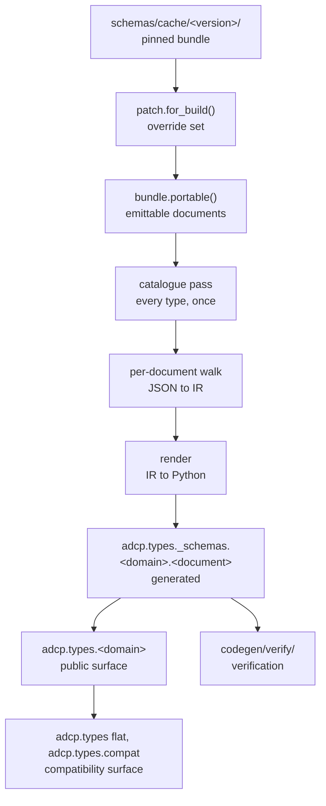
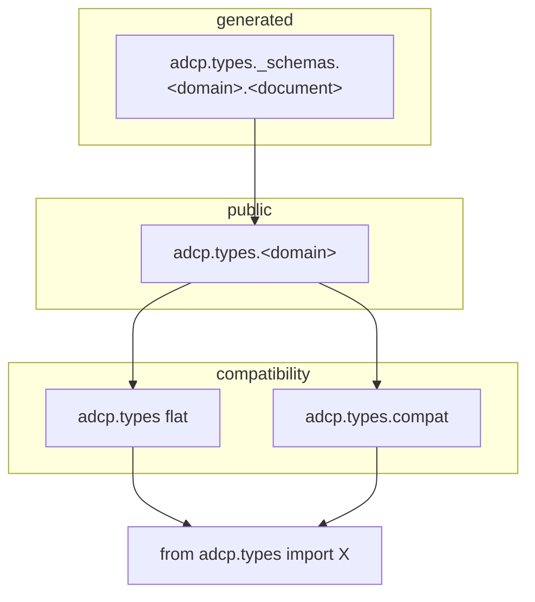

# Type generation

Status: current.

## Scope

This document specifies how Python types are produced from AdCP JSON Schema documents, the
surfaces the result is exposed on, and the properties the output is required to hold. It is
the reference for changing the pipeline or reading its output.

For the type surface from a consumer's perspective, see
[../type-surface.md](../type-surface.md). For subclassing a generated type, see
[../extending-types.md](../extending-types.md).

This document states no measurements. Current figures are produced by `./check`.

## Overview

The generator is `codegen/`, in this repository. It reads the pinned schema bundle and is
the only mechanism that produces a class from a schema. No third-party code generator is
used, and no pass rewrites generated Python after it is written.

Each stage is a separate module. A decision is made in exactly one of them.

## Terminology

**Bundle.** A directory under `schemas/cache/` holding one AdCP schema release.

**Document.** One JSON Schema file within a bundle.

**Record.** A document with every cross-document reference inlined. The record is the form
all downstream stages read.

**Node.** A subschema within a record, identified by its document and its JSON pointer.

**Portable set.** The documents of a bundle that can be emitted.

**Approximated fact.** A keyword the generator cannot express in an annotation, recorded
with its pointer and reason.

## The bundle

`src/adcp/ADCP_VERSION` pins the schema release. `resolve_bundle_key` resolves it to a
bundle directory. The generator names no version of its own: the bundle is an argument, so
the generator answers for whichever release it is given.

Each bundle directory has a provenance record beside it naming the repository, the commit,
and the artifact the bundle was built from. The provenance record is the only source for
which upstream a bundle represents. A bundle built from a fork carries that fork's
modifications as document text, and bundle contents do not distinguish a published node
from an added one.

## The override set

`codegen.patch.for_build` applies the override set to the published bundle and materialises
the result. Every entry point reads the bundle through this function: the generator,
`./check`, and verification. One patched bundle exists per run.

Each override entry declares the defect in the published document that it compensates for,
and fails once that defect is absent from the bundle. An override that the build does not
apply is a build failure, asserted against the artifact rather than against the table.

## Document selection

`bundle.portable()` derives the portable set from the bundle. The set is derived, not
enumerated: a document added to a bundle is compiled when the bundle is next pinned,
without an edit to a list.

A document that cannot be emitted produces a refusal carrying its pointer and the keyword
responsible. The generator mints one class of refusal: the document has no defined accepted
set, because a reference leaves the bundle or a reference cycle crosses documents.

## The record

Each document is resolved into a record before lowering. Cross-document references are
inlined; local references are preserved as written. Annotation keywords beside a reference
are kept, and the referring node's value wins where both state one.

A record's text is a directed acyclic graph: a repeated subtree is stored once and
referenced at each occurrence. Readers of a record traverse the graph. A reader that
traverses the unfolded tree instead pays the cost of unfolding.

The record is the schema that `strict_validate` validates against and the schema that
verification grades against.

## The catalogue pass

One pass over the bundle collects every type before any module is written. The pass is
layered, bottom upward: scalars and enums; objects; the types a document applies at a
position; shapes. The per-document walk then emits against the catalogue.

A type that two documents state identically is one declaration with one name. This is
decidable only by a pass that has observed both documents, which is why the catalogue
precedes the walk.

A catalogue entry's name is derived from the bundle: a `title`, the document root, or the
nearest titled ancestor and the node's key.

## Naming

A name is derived from the document. A name is not derived from a position.

- A node with a `title` takes that title.
- A document root takes the document's name.
- An untitled inner node takes the nearest titled ancestor's export word and the node's
  key, read transitively.

The rule is unconditional. A name selected according to whether a collision occurs would
change when an unrelated document introduced a colliding key.

Enum member names are the sanitiser's output. The document's own spelling is bound beside
each member as an alias, so both spellings resolve to one member and the enum's member map
is unchanged.

## Output surfaces

The generated tree is private and may change between schema releases. The public surface is
what applications import. The separation allows a generated class to change without
affecting an import.

Two properties are required of the public surface and are gated:

1. Every declared class is exported.
2. No class is reachable at more than one public path.

The gate counts declarations. It does not count names, and it does not use object identity:
several documents stating the same constrained scalar each emit an alias statement, which
the runtime interns to one object, so an identity-keyed gate would report those as
violations for which no repair exists.

Not every export is a class. A node that is a constrained scalar or a union of scalars has
a type and no class. The export requirement is satisfied by an annotated type as it is by a
class.

Three envelope bases — `AdcpRequest`, `AdcpResponse`, `FailedResponse` — are hand-written
and carry what every request or response has in common. They are applied to the root class
of each document that the bundle's task registry names in the corresponding slot.

## Keyword compilation

`docs/plan/rebuild-plan.md` §5 specifies the compilation of each draft-07 keyword, with an
answer per position where positions differ. The tables in that section are generated from
`codegen/keywords.py`: a cell is the single location of a keyword decision, and the table is
its rendering.

Two rules govern all rows:

- Constraints bind to the type, not to the field. A constrained scalar is a named
  `Annotated` alias, so two fields stating the same constraint share one name.
- A keyword that cannot be expressed widens the annotation and is recorded as an
  approximated fact carrying the keyword, the pointer, and the reason. Such a keyword is
  never dropped without record. An approximated fact asserts that the model is wider at
  that position, and verification proves the assertion by offering a value the document
  admits.

## Verification

`codegen/verify/` grades the generated types against the records they were generated from.
Three assertions are made at each node:

| witness | subject | required outcome |
|---|---|---|
| the constructed value the document admits | the generated class | accepted |
| each violation of one keyword the node states | the generated class | refused, at that location |
| the accepted value, instantiated and dumped | the document | accepted |

The first establishes that the class is no narrower than its document; the second, that it
is no wider; the third, that the class's output conforms to the document.

Witnesses are constructed, not sampled. A node's keywords state what the node admits, so a
value is read from them: a stated constant, the first enum member, the required keys, the
minimum count a bound demands, and for a reference the value already constructed for its
target. Construction proceeds bottom upward and is memoised on `(document, pointer, stack)`.
Each node is constructed once. A reference reaching a pointer whose construction is in
progress is a back edge, resolved by omission where the document makes the reference
optional and by the target's minimal value where the document requires it.

Consequently:

- No check carries a time budget, a recursion limit, or an example count.
- Nothing is retained between runs. No corpus of values is stored or versioned, and a fresh
  checkout grades a bundle at the cost of a warm one.

Where construction cannot produce a value, the document's own `examples` is used. Where the
document states no example, the position is recorded as an approximated fact with its
reason.

Pattern support is limited by specification. The reader covers an anchor, a literal run, a
character class, and a quantifier. Every other construct is declined by name and recorded.
No general regular-expression evaluation is performed, in either direction: a pattern is
read in order to produce a string, and every accept-or-refuse decision belongs to the
document's own validator.

## Compatibility surface

Upstream modules and tests import names that this generator spells differently.
`adcp.types.compat` binds each upstream spelling to the object of this tree that it names.

- Generated classes retain names derived from their documents.
- Every binding is a re-export. An alias is a name and not a second type: `isinstance`
  holds across both spellings, the alias and the generated attribute are the same object,
  and the count of declarations is unchanged.
- An alias is keyed on the schema subject — a field set read by wire alias, or an enum's
  value list — and not on the name.

Where upstream collapsed a composition that this generator keeps separate, the alias is a
union of the generated types. A union alias is a name and carries no declaration.

## Related documents

| subject | document |
|---|---|
| required properties of the finished artifact | `docs/plan/final-state.md` |
| layering, and what crosses each seam | `docs/plan/architecture.md` |
| per-keyword compilation | `docs/plan/rebuild-plan.md` §5 |
| the generator's entry point | `codegen/__main__.py` |
| available instruments | `python -m survey` |

`python -m survey` enumerates each instrument with the question it answers. The list is
derived from the filesystem.
